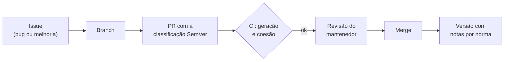

# Como contribuir

Contribuições vêm de consultores e de empresas que usam o esqueleto: melhoria que vale
para todos entra aqui; o que é de uma empresa só fica em `config/` e `acrescimos/` do repositório dela.

## Antes de abrir uma PR

- [ ] A mudança vale para empresas do perfil (tecnologia e software, pequeno e médio porte), não para um caso só
- [ ] Nenhum nome de pessoa, cliente ou marca real; exemplos usam `nClient`, `A. Usuário`, `ncliente.com`
- [ ] Regra nova entra em norma existente; norma nova só com aprovação do mantenedor
- [ ] Cada regra num lugar só; as outras normas apontam para ela ([unicidade](docs/glossario.md#onde-mora-cada-regra))
- [ ] Termos do [glossário](docs/glossario.md)
- [ ] Parâmetro novo tem recomendação padrão e motivo
- [ ] IDs de seção existentes não mudam
- [ ] `npm run gerar` e `npm run coesao` sem problemas, com só o núcleo e com todos os módulos

## Fluxo

## Classificação da mudança

| Tipo | Quando | Efeito para quem usa |
| --- | --- | --- |
| **patch** | Correção de texto, sem mudar regra | Merge direto |
| **minor** | Regra ou parâmetro novo, com padrão | Merge; novo item pode aparecer em Pontos a decidir |
| **major** | Regra existente mudou, ou parâmetro novo sem padrão aceitável | Nova rodada parcial da entrevista |

## Estilo

Português do Brasil, direto e técnico. Sem emoji, sem exclamação, sem superlativo. Conformidade sempre como "alinhada
aos requisitos", nunca "certificada". Frases que dizem a consequência e quem faz.
