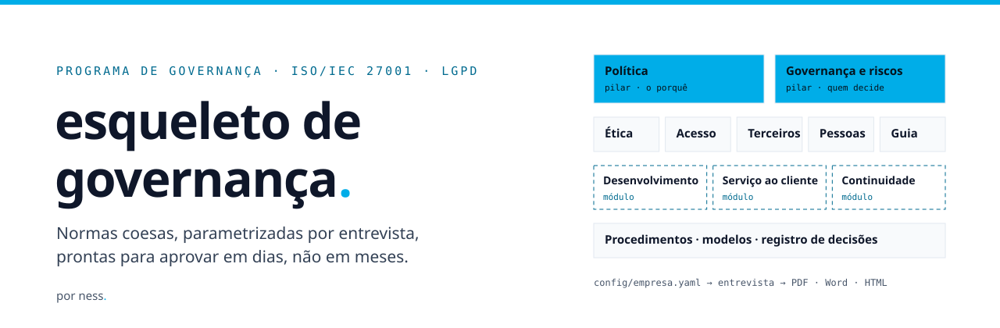
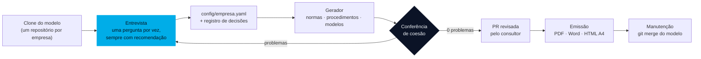

<picture>
  <source media="(prefers-color-scheme: dark)" srcset="assets/banner-escuro.svg">
  
</picture>

<p align="center">
  
  
  
  
  
  
</p>

<p align="center">
  <a href="#como-funciona">Como funciona</a> ·
  <a href="#o-que-sai-do-outro-lado">O que sai</a> ·
  <a href="#normas-e-módulos">Normas</a> ·
  <a href="#como-usar">Como usar</a> ·
  <a href="#sua-identidade-visual">Identidade visual</a> ·
  <a href="docs/">Documentação</a> ·
  <a href="#roteiro">Roteiro</a>
</p>

---

Programa de governança costuma nascer de um pacote de 30 políticas copiadas, sem dono, que ninguém lê e que se
contradizem na terceira página. Este repositório faz o contrário: **um acervo pequeno, coeso e verificado por máquina**,
em que cada regra mora num lugar só, cada decisão tem dono e data, e o que é específico da empresa vive num único
arquivo de configuração.

É o mesmo acervo que a NESS escreveu e usa para governar a própria operação (dez normas, todo o Anexo A da
ISO/IEC 27001:2022 mapeado), generalizado para **empresas de tecnologia e desenvolvimento de software**, de pequeno e
médio porte, em que as funções executivas se acumulam e o programa precisa caber na rotina.

> [!NOTE]
> **Estado atual:** especificação aprovada para revisão; a implementação começa pelo [roteiro](#roteiro). Os comandos
> desta página descrevem o funcionamento previsto.

## Como funciona



1. **O texto é fixo; a empresa é configuração.** As normas trazem marcadores (`{{alcadas.cfo}}`) e trechos por módulo.
   O cliente não edita norma: responde a entrevista, e o que for próprio entra em `acrescimos/`.
2. **Nada trava por falta de resposta.** Parâmetro sem valor sai com a recomendação padrão e vira item de *Pontos a
   decidir* da norma, com a proposta escrita. O documento nasce completo e honesto sobre o que falta.
3. **A coesão é verificada, não prometida.** Glossário único, estrutura padrão, pessoas só no anexo de designações,
   exceções sempre pelo mesmo processo: a conferência reprova a PR que quebrar qualquer uma dessas regras.

## O que sai do outro lado

| Entrega | Formato | Para quem |
| --- | --- | --- |
| Política e normas aprovadas pela direção | PDF e Word A4 com capa, sumário, fluxos e controle de quebras | Colaboradores, clientes e auditoria |
| Procedimentos com papéis, passos e prazos | Markdown e PDF | Quem executa |
| Registro de riscos (ISO 31000), revisão de acessos, exceções e indicadores | Planilhas-modelo | Quem opera o programa |
| Registro de decisões | Markdown datado, um por mês | Direção e auditoria |
| Mapa de cobertura do Anexo A | Tabela gerada | Responsável pelo SGSI e auditor |

## Normas e módulos

**Núcleo** (toda implantação) e **módulos** escolhidos na entrevista. Detalhes e cobertura em
[docs/normas.md](docs/normas.md).

| | Documento | O que decide |
| --- | --- | --- |
| Pilar | **Política de segurança e privacidade** | O que a empresa protege, por quê e com que compromisso da direção |
| Pilar | **Governança e gestão de riscos** | Quem decide, quem aceita risco, alçadas, comitês, método ISO 31000 |
| Núcleo | Ética e conduta | Integridade, conflito de interesse, canal de relato |
| Núcleo | Acesso e ativos | Concessão, revisão e revogação; inventário; criptografia; redes |
| Núcleo | Fornecedores e terceiros | Criticidade, avaliação, cláusulas, reavaliação |
| Núcleo | Pessoas | Entrada, saída, termos, conscientização, processo disciplinar |
| Núcleo | Guia do colaborador | O dia a dia em linguagem simples |
| Módulo | Desenvolvimento seguro, mudanças e projetos | Ciclo seguro, GMUD, vulnerabilidades, projetos |
| Módulo | Serviço ao cliente | Ativos e dados de clientes, acordo de segurança, notificação |
| Módulo | Incidentes e continuidade | Resposta, comunicação, backup, RTO e RPO |

## Como usar

Você não escreve norma nenhuma: responde perguntas e recebe os documentos prontos, com a sua marca.

| Passo | Você faz | Você recebe |
| --- | --- | --- |
| **1. Criar** | Cria o repositório da sua empresa a partir deste modelo | Um repositório privado só seu |
| **2. Responder** | Roda `/entrevista-governanca` no Claude Code e responde uma pergunta por vez | `config/empresa.yaml` preenchido e o registro das suas decisões |
| **3. Aplicar a sua marca** | Coloca logotipo, cores e fontes em `config/` ([como](docs/identidade-visual.md)) | Documentos com a cara da sua empresa |
| **4. Gerar e conferir** | `npm run gerar` e `npm run coesao` | PDF, Word e HTML de cada norma, e a lista do que ficou a decidir |
| **5. Validar e aprovar** | Abre a PR; o consultor revisa e a direção aprova com o merge | A primeira emissão oficial |
| **6. Manter** | Puxa as versões novas do modelo quando sair uma | Melhorias sem perder o que é seu |

```bash
gh repo create minha-empresa/governanca --private --template resper1965/esqueleto-governanca
cd governanca
/entrevista-governanca                 # no Claude Code
npm run gerar && npm run coesao
gh pr create --title "Primeira emissão"
```

O que é seu e o que é do modelo:

| Seu (edite à vontade) | Do modelo (não edite) |
| --- | --- |
| `config/` respostas, marca e tema | `normas/` texto das normas |
| `acrescimos/` texto próprio por seção | `procedimentos/`, `modelos/`, `ferramentas/` |
| `decisoes/` registro das decisões | |

Passo a passo completo, com o papel do consultor e da empresa: [docs/implantacao.md](docs/implantacao.md).

## Sua identidade visual

Os documentos saem com a sua marca. Três níveis, escolha o que você já tem:

| Nível | Você fornece | Resultado |
| --- | --- | --- |
| **Nenhum** | Nada | Padrão neutro, sóbrio, pronto para circular |
| **Básico** | Logotipo, uma cor de destaque e as fontes, em `config/empresa.yaml` | Capa, títulos e destaques com a sua marca |
| **Design system** | Seus tokens (`config/tema/tokens.json` no formato W3C ou `config/tema/tema.css`) e, se quiser, um Word modelo | Cores, tipografia, espaçamentos, tabelas e figuras do seu design system |

O conteúdo nunca muda com o tema: só a aparência. Detalhes, tokens aceitos e exemplos em
[docs/identidade-visual.md](docs/identidade-visual.md).

## Princípios

- **Menos documentos.** Assunto novo entra em documento existente; documento novo só com aprovação da direção.
- **Uma regra, um lugar.** As demais normas apontam para ela ([tabela de unicidade](docs/glossario.md#onde-mora-cada-regra)).
- **Decisão tem dono e data.** Toda escolha da entrevista vira linha no registro de decisões.
- **Nenhum valor inventado.** O que não foi decidido aparece como ponto a decidir, com recomendação.
- **Segregação de funções desde o desenho.** Quem executa não aprova, quem confere não executa, e o acúmulo de funções
  da empresa pequena tem controle compensatório explícito.
- **Alinhado aos requisitos** da ISO/IEC 27001 e 27701 e da LGPD. O esqueleto não certifica ninguém: prepara o terreno
  para quem quiser certificar.

## Documentação

| Documento | Conteúdo |
| --- | --- |
| [Especificação](docs/especificacao.md) | Objetivo, decisões de desenho, escopo e entregas |
| [Arquitetura](docs/arquitetura.md) | Estrutura do repositório, parametrização, geração e CI |
| [Implantação](docs/implantacao.md) | Do clone à primeira emissão, e a manutenção |
| [Entrevista](docs/entrevista.md) | Roteiro, ordem das perguntas e como as respostas são gravadas |
| [Parâmetros](docs/parametros.md) | Referência do `config/empresa.yaml` |
| [Identidade visual](docs/identidade-visual.md) | Como aplicar a sua marca ou o seu design system |
| [Normas](docs/normas.md) | Catálogo, módulos e cobertura do Anexo A |
| [Glossário](docs/glossario.md) | Vocabulário único e onde mora cada regra |

## Roteiro

- [x] Especificação
- [x] Documentação do repositório
- [ ] Gerador e conferência de coesão portados do acervo de origem
- [ ] Normas do núcleo generalizadas, com marcadores
- [ ] Módulos: desenvolvimento, serviço ao cliente, continuidade
- [ ] Cobertura completa do Anexo A (hoje 81 de 93 controles no acervo de origem; [lista](docs/normas.md#cobertura-do-anexo-a))
- [ ] `config/empresa.yaml`: esquema, valores padrão e empresa exemplo
- [ ] Procedimentos e planilhas-modelo
- [ ] Skill de entrevista
- [ ] CI do modelo
- [ ] Piloto com uma empresa real

## Perguntas frequentes

<details>
<summary><strong>Isso certifica a empresa na ISO/IEC 27001?</strong></summary>

Não. O esqueleto entrega a base documental e de decisão alinhada aos requisitos da norma. Certificação depende de
operar o SGSI, gerar evidência e passar por organismo certificador.
</details>

<details>
<summary><strong>Por que um repositório Git e não um pacote de documentos Word?</strong></summary>

Porque a coesão se perde na primeira edição solta. Com Git, toda revisão de norma é uma PR revisada, a conferência
roda sozinha e as melhorias do modelo chegam por merge. O público-alvo, empresas de software, já trabalha assim.
</details>

<details>
<summary><strong>E se a empresa não usar IA?</strong></summary>

A entrevista também pode ser conduzida pelo consultor preenchendo `config/empresa.yaml` à mão. A skill só acelera e
padroniza.
</details>

<details>
<summary><strong>Posso mudar o texto de uma norma?</strong></summary>

O texto do modelo não se edita no repositório do cliente; o que é próprio entra em `acrescimos/` e aparece no ponto
indicado. Melhoria que vale para todos vira PR no modelo.
</details>

---

<p align="center">
  <sub>Feito pela <strong>NESS</strong> a partir do acervo de normas que governa a própria operação ·
  <a href="CONTRIBUTING.md">Como contribuir</a> · <a href="SECURITY.md">Segurança</a> · <a href="LICENSE">Uso restrito</a></sub>
</p>
