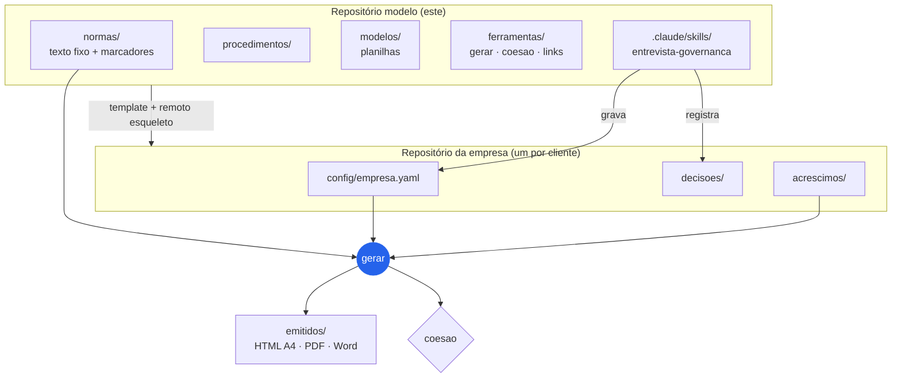
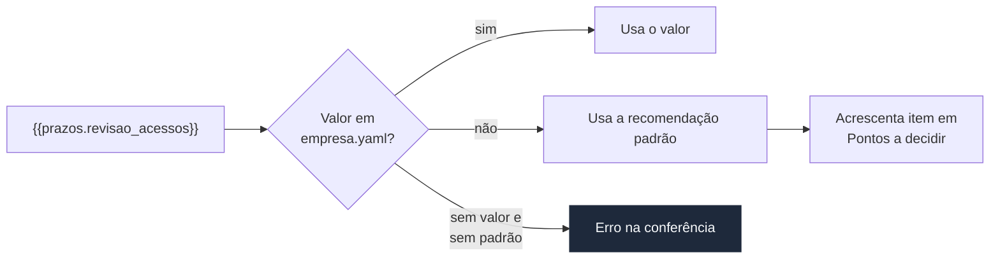
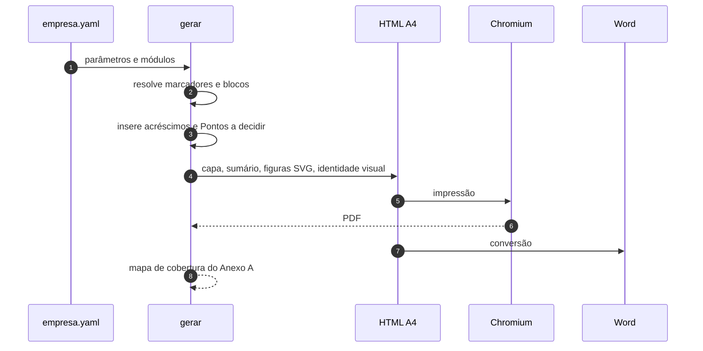
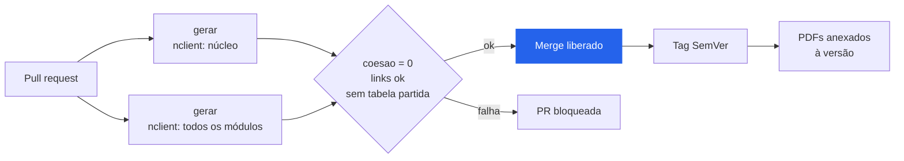

# Arquitetura

Como o repositório se organiza, como o texto fixo vira o documento de uma empresa e o que a CI confere.

> [!NOTE]
> Descreve o funcionamento previsto na [especificação](especificacao.md). Nomes de comando podem mudar na implementação.

## Visão geral



A separação é o centro do desenho: **o modelo é dono do texto, a empresa é dona da configuração**. Por isso a
atualização do modelo chega por `git merge` sem conflito na maior parte das vezes.

## Estrutura

```text
config/empresa.yaml      parâmetros da empresa (única fonte do que é específico)
normas/                  texto fixo das normas, com marcadores e trechos por módulo
procedimentos/           procedimentos em texto (papéis, passos e prazos)
modelos/                 planilhas: riscos, revisão de acessos, exceções, indicadores, decisões
decisoes/                registro de decisões da empresa, um arquivo por mês
acrescimos/              texto próprio da empresa, anexado às normas sem editá-las
ferramentas/             gerador, conferência de coesão, verificação de links
.claude/skills/entrevista-governanca/   a entrevista
.github/workflows/       conferência e geração em toda PR; publicação dos PDFs na versão
exemplo/nclient.yaml     empresa fictícia usada nos testes do modelo
```

| Pasta | Dono | Quem edita |
| --- | --- | --- |
| `normas/`, `procedimentos/`, `modelos/`, `ferramentas/` | Modelo | Só por PR no repositório modelo |
| `config/` | Empresa | A entrevista, ou o consultor |
| `decisoes/` | Empresa | A entrevista acrescenta; ninguém apaga |
| `acrescimos/` | Empresa | A empresa, com revisão do consultor |

## Parametrização

Três mecanismos, e só eles.

**Marcador** — valor vindo de `config/empresa.yaml`:

```markdown
Contratações acima de {{alcadas.contratacao.limite}} são aprovadas pelo {{cargos.cfo.titulo}}.
```

**Bloco por módulo** — trecho que só existe se o módulo foi escolhido:

```markdown
{{#modulo.desenvolvimento}}
Toda mudança em produção segue a norma de Desenvolvimento seguro, seção 4.
{{/modulo.desenvolvimento}}
```

**Acréscimo** — texto próprio da empresa, sem tocar no texto fixo. `acrescimos/acesso.md`:

```markdown
---
secao: "3.2"
---
O acesso remoto ao laboratório de testes exige, além do MFA, a VPN dedicada do laboratório.
```

O acréscimo é renderizado ao fim da seção indicada, com marcação visual de texto da empresa.

### Valor ausente



A emissão nunca para por falta de resposta e nunca inventa: o que não foi decidido sai com a recomendação e com o aviso.

## Geração



- **Capa e identidade visual** vêm de `config/empresa.yaml` (logotipo, cor de destaque, fontes); sem elas, sai o padrão
  neutro.
- **Controle de quebras**: tabela e figura não se partem entre páginas; título não fica órfão no pé.
- **Figuras** são SVG com marcador `<!-- figura: nome | legenda -->`, para o fluxo ficar no texto e o desenho ficar
  versionado.

## Conferência de coesão

`ferramentas/coesao` reprova a PR que quebrar qualquer regra abaixo. Zero problemas é condição de merge.

| Regra | O que reprova |
| --- | --- |
| Glossário único | Sinônimo proibido no texto ("gestor imediato" onde o termo é "gestor") |
| Estrutura padrão | Norma sem Objetivo, Escopo, Papéis, Regras, Exceções e medição, Revisão |
| Pessoas só no anexo | Nome de pessoa fora do anexo de designações |
| Pontos a decidir | Item sem recomendação |
| Exceções | Exceção tratada fora do processo único de exceções |
| Unicidade | Regra repetida em duas normas em vez de referência |
| Marcadores | Marcador sem valor e sem recomendação padrão |

## CI



No repositório do cliente, a mesma conferência roda com o `config/empresa.yaml` dele.
