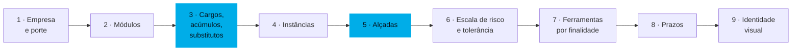

# Entrevista

A entrevista transforma o conhecimento da direção em parâmetros. É a parte que mais economiza tempo: decisões que
levariam reuniões viram respostas curtas a perguntas com recomendação pronta.

## Regras da entrevista

1. **Uma pergunta por vez.** Nada de questionário de 40 itens.
2. **Sempre com recomendação e motivo.** A resposta mais comum é "sigo a recomendação".
3. **Resposta curta.** Se a pergunta exige texto longo, ela está errada.
4. **Toda resposta é gravada duas vezes:** o valor em `config/empresa.yaml` e uma linha datada em `decisoes/`.
5. **"Não sei" é resposta válida.** Fica a recomendação padrão e o item entra em *Pontos a decidir*.

## Ordem



Os blocos 3 e 5 concentram as decisões de segregação de funções; a skill pede confirmação explícita neles.

| Bloco | O que decide | Exemplo de pergunta |
| --- | --- | --- |
| 1. Empresa e porte | Razão social, marcas, faixa de colaboradores, faturamento de referência | Quantas pessoas, incluindo PJ? |
| 2. Módulos | Desenvolvimento, serviço ao cliente, continuidade | A empresa opera ambiente ou dado de cliente? |
| 3. Cargos | Quem ocupa cada papel, acúmulos e substitutos | Quem responde pelo SGSI, e quem substitui? |
| 4. Instâncias | Comitês ativos e frequência | Comitê de mudanças separado ou dentro do de riscos? |
| 5. Alçadas | Limites de aprovação | Até quanto o gestor contrata sem a diretoria? |
| 6. Risco | Escala de impacto e apetite | Qual perda, em % do faturamento, é crítica? |
| 7. Ferramentas | Onde cada coisa é registrada | Onde ficam os chamados internos? |
| 8. Prazos | Revisões, retenções, correções | Em quanto tempo corrigir vulnerabilidade crítica? |
| 9. Identidade | Logotipo, cor, fontes | Envie o logotipo em SVG |

## Exemplo

```text
Pergunta 14 de 38 · Alçadas

Até que valor o gestor da área aprova uma contratação de fornecedor
sem passar pela diretoria financeira?

Recomendação: 1% do faturamento anual de referência (R$ 120.000,00
para o faturamento informado).
Motivo: abaixo disso o volume de aprovações trava a diretoria; acima,
o risco de concentração passa do apetite definido no bloco 6.

> sigo a recomendação
```

Grava em `config/empresa.yaml`:

```yaml
alcadas:
  contratacao:
    gestor_limite: 0.01   # fração do faturamento de referência
```

E em `decisoes/2026-11.md`:

```markdown
| 13/11/2026 | alcadas.contratacao.gestor_limite | 1% do faturamento | Recomendação padrão aceita | Patrocinador |
```

## Escalas em percentual do faturamento

Valores monetários são guardados como fração do faturamento de referência, e o gerador converte para reais na emissão.
A régua acompanha o crescimento da empresa sem nova rodada de entrevista: muda o faturamento, mudam os valores.

## Sem IA

A skill acelera e padroniza, mas não é obrigatória. O consultor pode preencher `config/empresa.yaml` à mão seguindo
[parametros.md](parametros.md) e registrar as decisões no mesmo formato.
