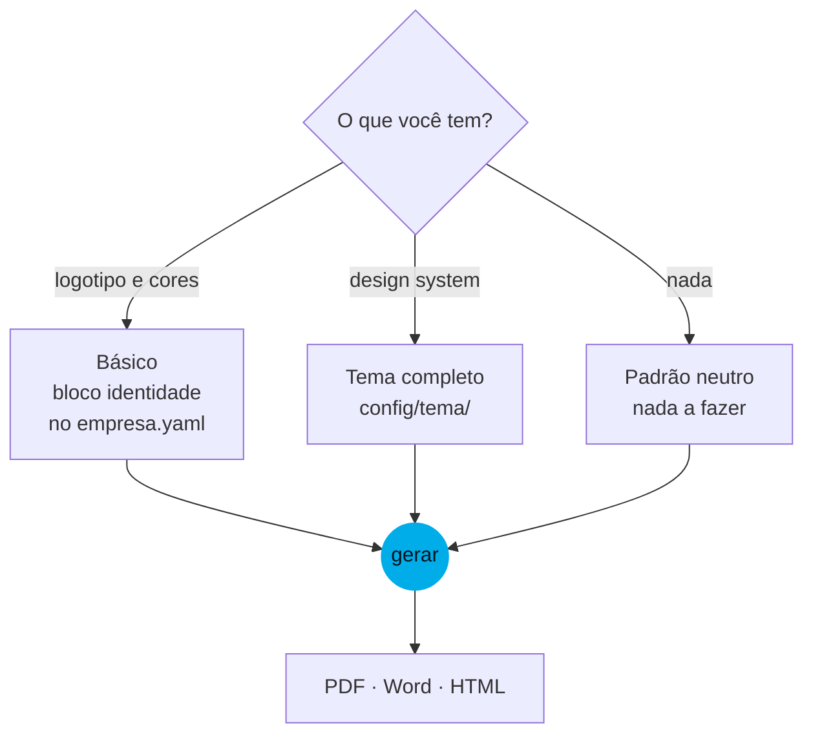

# Identidade visual

Os documentos saem com a marca da sua empresa. O tema muda a aparência; o texto, a numeração e as regras continuam os
mesmos, por isso o tema nunca reprova a conferência de coesão.

> [!NOTE]
> Descreve o funcionamento previsto. Entra com o gerador (entrega 1 do [roteiro](../README.md#roteiro)).

## Escolha o nível



Precedência: tema completo > básico > padrão neutro. Um token que o seu tema não define vem do nível de baixo.

## Nível básico

Em `config/empresa.yaml`:

```yaml
identidade:
  logotipo: config/logotipo.svg        # SVG de preferência; PNG com 600 px de largura ou mais
  logotipo_capa: config/logotipo-negativo.svg   # opcional, para capa com fundo escuro
  cor_destaque: "#2563EB"
  fonte_titulos: Montserrat            # Google Fonts pelo nome, ou arquivo em config/fontes/
  fonte_texto: Inter
```

O gerador calcula a partir da cor de destaque o tom para texto e links com contraste mínimo de 4,5:1 sobre fundo
branco. Se a sua cor não passar, ela continua nos preenchimentos e o texto usa um tom mais escuro dela.

## Nível design system

Coloque os arquivos em `config/tema/`:

```text
config/tema/
├── tokens.json      tokens no formato W3C Design Tokens (DTCG)    ou
├── tema.css         as mesmas variáveis em CSS
├── fontes/          arquivos .woff2, se as fontes não forem do Google Fonts
└── modelo.docx      opcional: estilos do Word (Título 1, Normal, Tabela...)
```

Use **um** dos dois, `tokens.json` ou `tema.css`. Se o seu design system já exporta tokens DTCG (Figma Tokens Studio,
Style Dictionary e similares exportam), copie o arquivo e mapeie os nomes no bloco `mapa` abaixo.

### Tokens que o gerador usa

| Token | Para quê | Padrão neutro |
| --- | --- | --- |
| `cor.destaque` | Faixa da capa, numeração, destaque de figuras | `#2563EB` |
| `cor.destaque-texto` | Links e rótulos coloridos | derivado, contraste ≥ 4,5:1 |
| `cor.sobre-destaque` | Texto sobre preenchimento de destaque | `#FFFFFF` ou `#000000`, o de maior contraste |
| `cor.texto` | Corpo | `#0F172A` |
| `cor.texto-secundario` | Legendas, rodapé, cabeçalho de tabela | `#475569` |
| `cor.superficie` | Caixas, figuras, zebra de tabela | `#F8FAFC` |
| `cor.linha` | Réguas e bordas | `#E2E8F0` |
| `fonte.titulos` | Títulos | Inter |
| `fonte.texto` | Corpo | Inter |
| `fonte.mono` | Códigos, IDs de seção, rótulos | ui-monospace |
| `raio` | Cantos de caixas e figuras | `0` |
| `espaco.base` | Unidade de espaçamento | `4px` |

Exemplo em `tema.css`:

```css
:root {
  --cor-destaque: #00ADE8;
  --cor-destaque-texto: #006A8F;
  --cor-sobre-destaque: #04121C;
  --fonte-titulos: "Montserrat";
  --fonte-texto: "Inter";
  --raio: 0;
}
```

Exemplo em `tokens.json` com nomes do seu design system mapeados:

```json
{
  "brand": { "primary": { "$type": "color", "$value": "#00ADE8" } },
  "text":  { "link":    { "$type": "color", "$value": "#006A8F" } }
}
```

```yaml
# config/empresa.yaml
identidade:
  tema: config/tema/tokens.json
  mapa:
    cor.destaque: brand.primary
    cor.destaque-texto: text.link
```

### Word

Sem `modelo.docx`, o Word sai com estilos derivados dos tokens. Com ele, o gerador usa os estilos do seu modelo pelo
nome (Título 1 a 3, Normal, Legenda, Tabela). Útil quando a empresa já tem papel timbrado no Word.

## O que o tema não muda

- Texto, numeração das seções e IDs
- Estrutura do documento: capa, sumário, Pontos a decidir, Aprovação
- Selo de classificação da informação e controle de versão no rodapé
- Conteúdo das figuras (o tema muda só cores e fontes delas)

## Conferência do tema

`npm run gerar` avisa, sem bloquear a emissão:

- Contraste de texto abaixo de 4,5:1
- Fonte não encontrada (usa a do nível de baixo)
- Logotipo raster com menos de 600 px de largura
- Token do mapa que não existe no `tokens.json`
