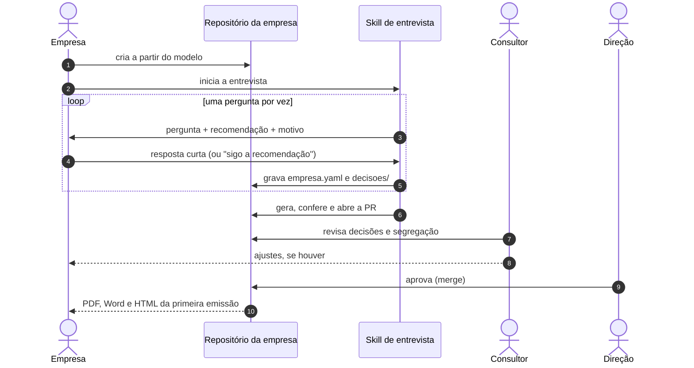
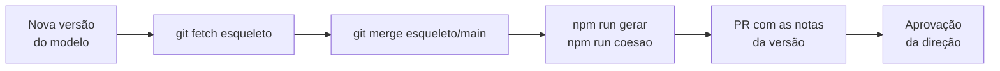

# Implantação

Do clone à primeira emissão aprovada, e como a empresa recebe melhorias depois.

> [!NOTE]
> Descreve o funcionamento previsto na [especificação](especificacao.md).

## Quem faz o quê

| Papel | Responsabilidade |
| --- | --- |
| **Patrocinador** (CEO ou sócio) | Responde as decisões de direção: alçadas, apetite a risco, quem aprova normas |
| **Ponto focal** da empresa | Conduz a entrevista do lado da empresa e reúne as respostas de cada área |
| **Consultor** | Revisa a PR: coerência com porte e setor, segregação de funções, acúmulos com controle compensatório |
| **Direção** | Aprova a primeira emissão e cada revisão, pelo processo que a própria norma de governança define |

## Linha do tempo



## Passo a passo

### 1. Criar o repositório da empresa

```bash
gh repo create cliente/governanca --private --template resper1965/esqueleto-governanca
git clone https://github.com/cliente/governanca && cd governanca
git remote add esqueleto https://github.com/resper1965/esqueleto-governanca
```

Um repositório por empresa, sempre privado.

### 2. Conduzir a entrevista

No Claude Code, na raiz do repositório:

```text
/entrevista-governanca
```

A ordem e o formato das perguntas estão em [entrevista.md](entrevista.md). A entrevista pode ser interrompida e retomada:
o estado é o próprio `config/empresa.yaml`.

### 3. Gerar e conferir

```bash
npm run gerar     # emitidos/: HTML A4, PDF e Word
npm run coesao    # precisa terminar com 0 problemas
```

Leia a seção *Pontos a decidir* de cada norma: é a lista do que ficou com a recomendação padrão.

### 4. Revisão do consultor

A entrevista abre a PR. O consultor confere, no mínimo:

- [ ] Alçadas coerentes com o faturamento e o porte
- [ ] Nenhum papel aprova o que ele mesmo executa
- [ ] Todo acúmulo de função tem controle compensatório escrito
- [ ] Substituto designado para cada papel de decisão
- [ ] Módulos escolhidos correspondem ao que a empresa faz
- [ ] Pontos a decidir aceitáveis para a primeira emissão

### 5. Aprovação e emissão

O merge da PR é a aprovação registrada. A tag da versão publica os documentos:

```bash
git tag v1.0.0 && git push --tags
```

## Manutenção



| Quando | O quê |
| --- | --- |
| Nova versão do modelo | Merge, geração, PR com o que mudou em cada norma |
| Mudança na empresa (cargo, alçada, módulo) | Nova rodada parcial da entrevista; PR |
| Revisão anual | A norma de governança define o rito; a PR registra a aprovação |
| Ponto a decidir resolvido | Valor em `empresa.yaml`, linha em `decisoes/`, PR |

Versões seguem SemVer: **patch** corrige texto sem mudar regra, **minor** acrescenta regra ou parâmetro com padrão,
**major** muda regra existente ou exige nova decisão da empresa.
