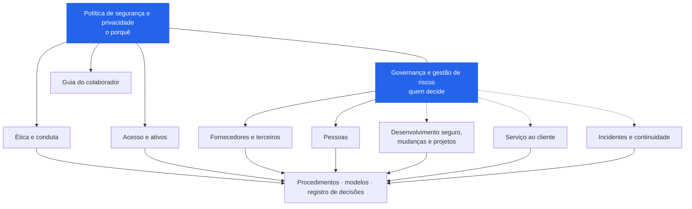
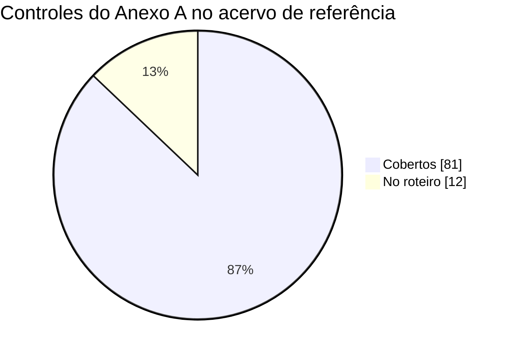

# Normas

O catálogo, o que cada norma decide e como o conjunto cobre o Anexo A da ISO/IEC 27001:2022.

## Hierarquia

Linha cheia: núcleo, presente em toda implantação. Linha tracejada: módulo, escolhido na entrevista.

## Catálogo

| Documento | Conjunto | Decide | Principais parâmetros |
| --- | --- | --- | --- |
| Política de segurança e privacidade | Pilar | Compromisso da direção, princípios, classificação, estrutura documental | `empresa`, `cargos.ceo` |
| Governança e gestão de riscos | Pilar | Papéis de decisão, alçadas, comitês, método de risco, exceções, auditoria interna | `cargos`, `instancias`, `alcadas`, `risco` |
| Ética e conduta | Núcleo | Integridade, conflito de interesse, canal de relato, diversidade | `ferramentas.canal_relato` |
| Acesso e ativos | Núcleo | Ciclo de acesso, inventário, criptografia, redes | `prazos.revisao_acessos`, `ferramentas.identidade` |
| Fornecedores e terceiros | Núcleo | Criticidade, avaliação, cláusulas, reavaliação | `alcadas.contratacao` |
| Pessoas | Núcleo | Entrada, saída, termos, conscientização, disciplinar | `prazos`, `cargos` |
| Guia do colaborador | Núcleo | O dia a dia em linguagem simples; aponta para as normas | — |
| Desenvolvimento seguro, mudanças e projetos | Módulo | Ciclo seguro, GMUD, vulnerabilidades, projetos | `prazos.vulnerabilidade_critica_dias`, `instancias.comite_mudancas` |
| Serviço ao cliente | Módulo | Ativos e dados de cliente, acordo de segurança, notificação | `prazos.notificacao_incidente_horas` |
| Incidentes e continuidade | Módulo | Resposta, comunicação, evidências, backup, RTO e RPO | `instancias.comite_crise` |

## Fluxos que acompanham as normas

Cada norma traz o fluxo principal desenhado em SVG, no texto:

| Fluxo | Norma |
| --- | --- |
| Ciclo de vida do acesso | Acesso e ativos |
| Entrada e saída de pessoas | Pessoas |
| Ciclo do fornecedor | Fornecedores e terceiros |
| Fluxo de mudança (GMUD) | Desenvolvimento seguro |
| Fluxo de incidente | Incidentes e continuidade |
| Alçadas e aceite de risco | Governança e riscos |

## Cobertura do Anexo A

Medida no acervo de referência a partir do qual o modelo é generalizado. Um controle conta como coberto quando ao menos uma seção de
norma o trata.

| Tema do Anexo A | Controles | Cobertos | Pendentes |
| --- | --- | --- | --- |
| 5. Organizacionais | 37 | 33 | 4 |
| 6. Pessoas | 8 | 8 | 0 |
| 7. Físicos | 14 | 11 | 3 |
| 8. Tecnológicos | 34 | 29 | 5 |
| **Total** | **93** | **81** | **12** |

### Pendentes

Entram durante a generalização, no documento indicado, sem criar norma nova.

| Controle | Título | Documento de destino |
| --- | --- | --- |
| 5.6 | Contato com grupos de interesse especial | Governança e riscos |
| 5.32 | Direitos de propriedade intelectual | Governança e riscos |
| 5.35 | Análise crítica independente da segurança da informação | Governança e riscos |
| 5.37 | Procedimentos de operação documentados | Governança e riscos |
| 7.11 | Serviços de infraestrutura (utilidades) | Política (segurança física) |
| 7.12 | Segurança do cabeamento | Política (segurança física) |
| 7.13 | Manutenção de equipamentos | Acesso e ativos |
| 8.6 | Gestão de capacidade | Incidentes e continuidade |
| 8.12 | Prevenção de vazamento de dados | Acesso e ativos |
| 8.18 | Uso de programas utilitários privilegiados | Acesso e ativos |
| 8.30 | Desenvolvimento terceirizado | Desenvolvimento |
| 8.34 | Proteção dos sistemas durante testes de auditoria | Governança e riscos |

### Por documento

| Documento | Controles do Anexo A |
| --- | --- |
| Política | 5.1, 5.2, 5.3, 5.4, 5.10, 5.11, 5.12, 5.13, 5.14, 5.31, 5.33, 5.34, 5.36, 6.2, 6.3, 6.4, 6.7, 7.1, 7.2, 7.3, 7.4, 7.5, 7.6, 7.7, 7.8, 7.9, 7.10, 7.14, 8.1, 8.7, 8.10 |
| Ética | 5.3, 5.4, 6.2, 6.3, 6.4 |
| Acesso e ativos | 5.9, 5.11, 5.15, 5.16, 5.17, 5.18, 6.8, 8.2, 8.3, 8.5, 8.7, 8.20, 8.21, 8.22, 8.23, 8.24 |
| Incidentes e continuidade | 5.24, 5.25, 5.26, 5.27, 5.28, 5.29, 5.30, 6.8, 8.13, 8.14, 8.15, 8.16, 8.17 |
| Desenvolvimento | 5.8, 8.4, 8.8, 8.9, 8.19, 8.25, 8.26, 8.27, 8.28, 8.29, 8.31, 8.32, 8.33 |
| Fornecedores | 5.19, 5.20, 5.21, 5.22, 5.23 |
| Pessoas | 5.10, 5.11, 5.16, 5.18, 6.1, 6.2, 6.3, 6.4, 6.5, 6.6 |
| Guia | — (guia: aponta para as normas) |
| Serviço ao cliente | 5.5, 5.9, 5.14, 5.15, 5.16, 5.17, 5.18, 5.19, 5.20, 5.21, 5.22, 5.24, 5.25, 5.26, 5.27, 5.28, 5.31, 5.33, 5.34, 6.6, 8.2, 8.3, 8.5, 8.8, 8.10, 8.11, 8.15, 8.19, 8.32 |
| Governança e riscos | 5.2, 5.3, 5.4, 5.7, 5.31 |

Um controle pode aparecer em mais de um documento: o principal trata a regra, os demais aplicam a regra ao seu contexto
(por exemplo, 5.24 na norma de incidentes e na de serviço ao cliente).
